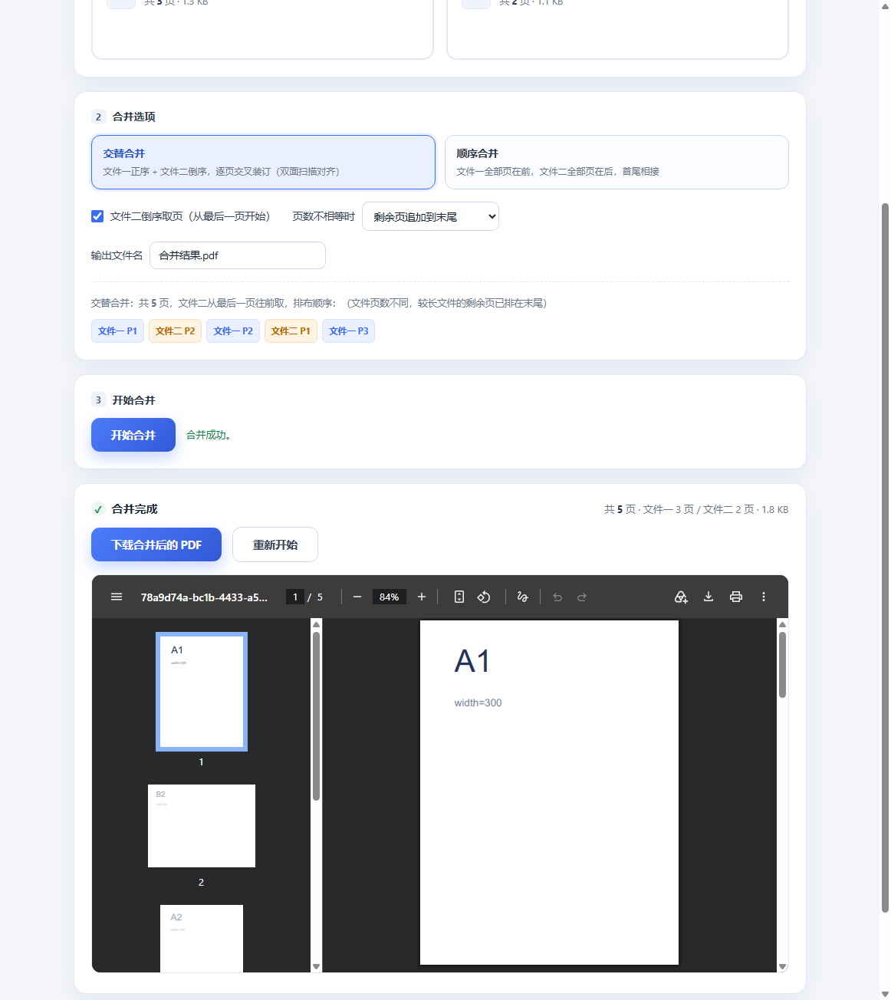
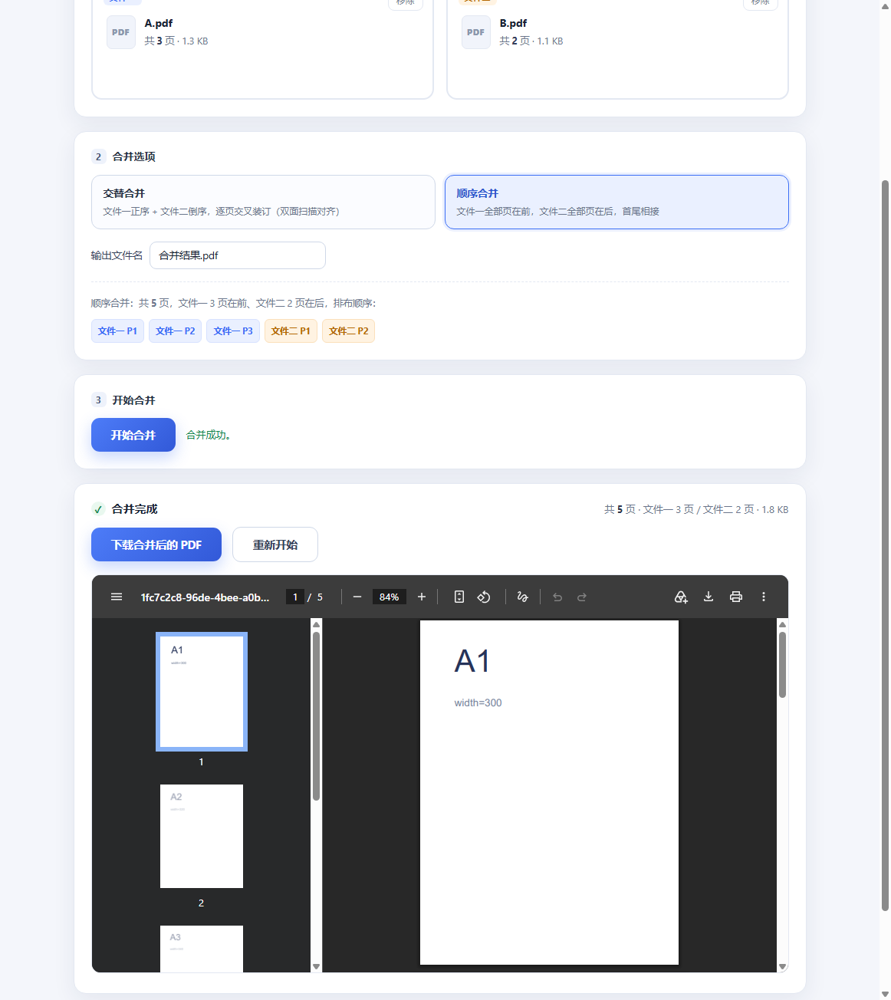

# PDF 合并工具（pdf-merge）

一个**纯本地、离线可用**的 PDF 双文件合并工具，带图形界面，无需安装任何软件——浏览器打开即用，文件全程不上传。

  

## ✨ 功能

- **交替合并**：文件一正序 + 文件二倒序，逐页交叉装订（双面扫描对齐场景）
- **顺序合并**：文件一全部页在前，文件二全部页在后，首尾相接
- 点击选择或拖拽导入 PDF，合并前即可预览确切的页面排布顺序
- 页数不相等时的两种策略：剩余页追加到末尾 / 只合并到较短文件为止
- 合并结果内嵌预览 + 一键下载，输出文件名可自定义
- 全程在浏览器本地完成，**文件不会上传到任何服务器**，原文件不会被修改

## 📷 界面预览

交替合并模式（结果面板含内置预览）：



顺序合并模式：



## 🚀 快速开始

**方式一：直接打开（最简单）**

双击 `index.html` 即可使用，无需联网、无需安装。

**方式二：本地服务器（推荐）**

```bash
cd pdf-merge
python -m http.server 8777
# 浏览器访问 http://127.0.0.1:8777
```

## 📖 合并规则

假设文件一有 3 页（A1、A2、A3），文件二有 2 页（B1、B2）：

**交替合并**（文件二默认从最后一页往前取）：

```
输出：A1, B2, A2, B1, A3
```

**顺序合并**：

```
输出：A1, A2, A3, B1, B2
```

页数不相等时（交替模式）可选：

- **剩余页追加到末尾**（默认）：较长文件多出的页接在结果最后
- **只合并到较短文件为止**：多余页直接舍弃

## 🧪 测试

核心逻辑与界面均有自动化测试：

```bash
# 1. 核心合并逻辑测试（7 个用例，需要 Node.js）
node test/verify.js

# 2. 浏览器端到端测试（需要 Node.js 22+ 和 Chrome）
#    先在项目目录启动本地服务器：
python -m http.server 8777
#    再运行（另开一个终端）：
node test/e2e.js
```

- `verify.js`：生成带标记的测试 PDF，逐页核对合并后的页面顺序
- `e2e.js`：通过 Chrome DevTools 协议驱动真实浏览器，模拟选择文件 → 点击合并 → 校验输出 PDF

## 📁 目录结构

```
pdf-merge/
├── index.html          # 图形界面（入口）
├── merge.js            # 核心合并逻辑（浏览器 / Node 双端复用）
├── pdf-lib.min.js      # pdf-lib 库（本地化，离线可用）
├── docs/               # 界面截图
└── test/
    ├── verify.js       # 核心逻辑测试
    ├── e2e.js          # 浏览器端到端测试
    └── out/            # 测试生成的样例文件（自动生成，已忽略）
```

## ⚠️ 已知限制

- 加密 PDF 需先用阅读器去除密码再导入
- 不会重新压缩页面内容，结果体积约为两文件之和（扫描件同理）
- 页面尺寸不同的两个文件可以直接合并，各自保持原尺寸

## 🛠️ 技术栈

- [pdf-lib](https://pdf-lib.js.org/) — 纯 JS 的 PDF 读写库，负责页面复制与输出
- 原生 HTML / CSS / JavaScript，零构建、零外部依赖

## 📄 许可证

[MIT](LICENSE)
